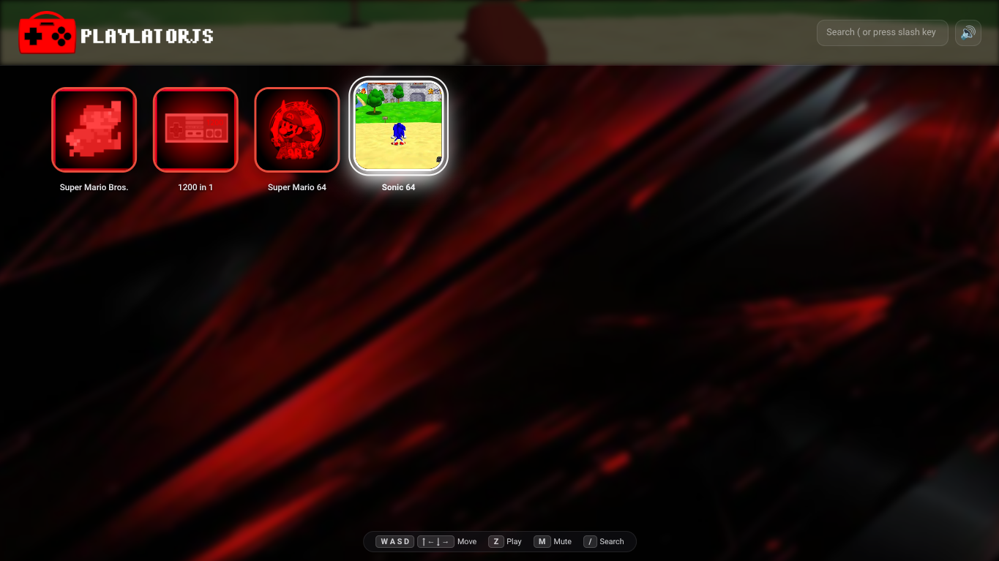

## Time to make web-based gaming even better.

**This project is NOT associated with EmulatorJS**. Emulator cores, webassembly code, and data is owned by emulatorJS. This is just a fork of it which contains a visual frontend, and ways to access these games on chrome file:// URLS, and working without wifi. I love portable gaming on my chromebook, and PlaylatorJS is letting me add real console games to that list.

**SEE THE ORIGIAL EMULATORJS AUTHORS HERE:**
https://github.com/EmulatorJS/EmulatorJS

## Playlator? Play later, even without wifi!

That's how it got its name. Also "Lator" in "Emulator" sounds like "Later" so it felt fitting. As long as your browser can access local ".js" and ".css" and video/image files, this will work offline and not need you to host a web server, so it even works on chromebooks. It also works on school chromebooks 🤫

## Visual frontend

Red and black frontend with icons, and previews on hover. you can use the mouse, or a keyboard.

wasd / arrow keys to move the game selector, z to enter games. Slash key "/" to jump to the search bar.

## Logo design

I gave it a red "virtual-boy" styled theme, as EmulatorJS has a blue theme. I also removed the bottom curve to make the logo look like a portable bag, which fits the offline portable gaming aesthetic.

**EmulatorJS Logo**

**PlaylatorJS Logo**

