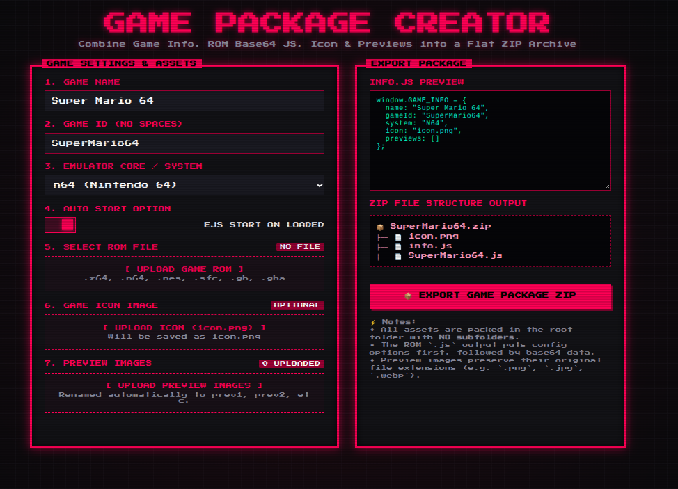

## Time to make web-based gaming even better.

**This project is NOT associated with EmulatorJS**. Emulator cores, webassembly code, and data is owned by emulatorJS. This is just a fork of it which contains a visual frontend, and ways to access these games on chrome file:// URLS, and working without wifi. I love portable gaming on my chromebook, and PlaylatorJS is letting me add real console games to that list.

**SEE THE ORIGIAL EMULATORJS AUTHORS HERE:**
https://github.com/EmulatorJS/EmulatorJS

## Playlator? Play later, even without wifi!

That's how it got its name. Also "Lator" in "Emulator" sounds like "Later" so it felt fitting. As long as your browser can access local ".js" and ".css" and video/image files, this will work offline and not need you to host a web server, so it even works on chromebooks. It also works on school chromebooks 🤫

## Visual frontend

Red and black frontend with icons, and previews on hover. you can use the mouse, or a keyboard.

wasd / arrow keys to move the game selector, z to enter games. Slash key "/" to jump to the search bar.


## Logo design

I gave it a red "virtual-boy" styled theme, as EmulatorJS has a blue theme. I also removed the bottom curve to make the logo look like a portable bag, which fits the offline portable gaming aesthetic.

**EmulatorJS Logo**


**PlaylatorJS Logo**


## Adding games

To add games to the frontend, you need a folder, "g[number]". For example if you have 5 games, name it "g6".

After that, the game needs an info file so the frontend can recognize it. Here is an example info.js file: 

```javascript
window.GAME_INFO = {
  name: "Super Mario Bros.",
  gameId: "SuperMarioBros",
  system: "NES",
  outline: "#e74c3c",
  icon: "icon.png",
  previews: ["prev1.png", "prev2.png", "prev3.png"]
};
```
**name:** This field is the game's name.
**gameId:** This field is the game's ID. It must have no spaces, it is the name of the game's data file(which contains the ROM).
Data files must be stored in: "PLATFORMS" inside the "app/games/" folder. inside "PLATFORMS", you will find "NES" and "N64". 
**Changing these names is bad, Leave them alone!**
Inside the folder(in this example is NES Mario), name it "[gameid].js". So "SuperMarioBros.js".

**system:** The system name. It must be a specific ID, or it won't work. expect a page on this in the future.
**outline:** Outline color for the icon. It's supposed to be red, so you can't change it in the packager tool.
**icon:** path to an icon image in the same folder.
**previews:** an array of preview images to show as a slideshow in the frontend.

Additionally, you can use the **Game Packager tool** in: "app/tools/Packager.html":

It allows you to set an icon, give it a name/ID, give it a system, and slideshow preview images to be displayed.
Then you can export a final ZIP file, which you can extract into "games/" and name "g2/3/4/5/etc". Keep in mind that you have to move the Game data JS file into the platform and system folder it goes to, or it won't launch.

## Other tools and stuff

I am planning to make an upcoming tool to turn games into a single truly offline file, no frontend, essentially a simpler version.

There is also an upcoming icon tool, but I'm lazy now so it's made with AI :p

**Go to the releases page to get a version of PlaylatorJS.**
**For many reasons I am not including any game ROMS in the releases. You have to get your own and package your own games.**
